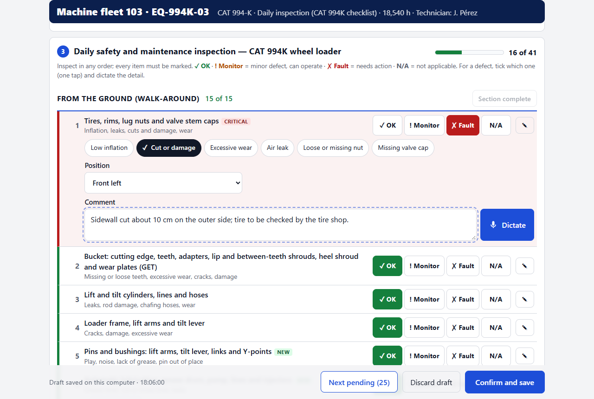
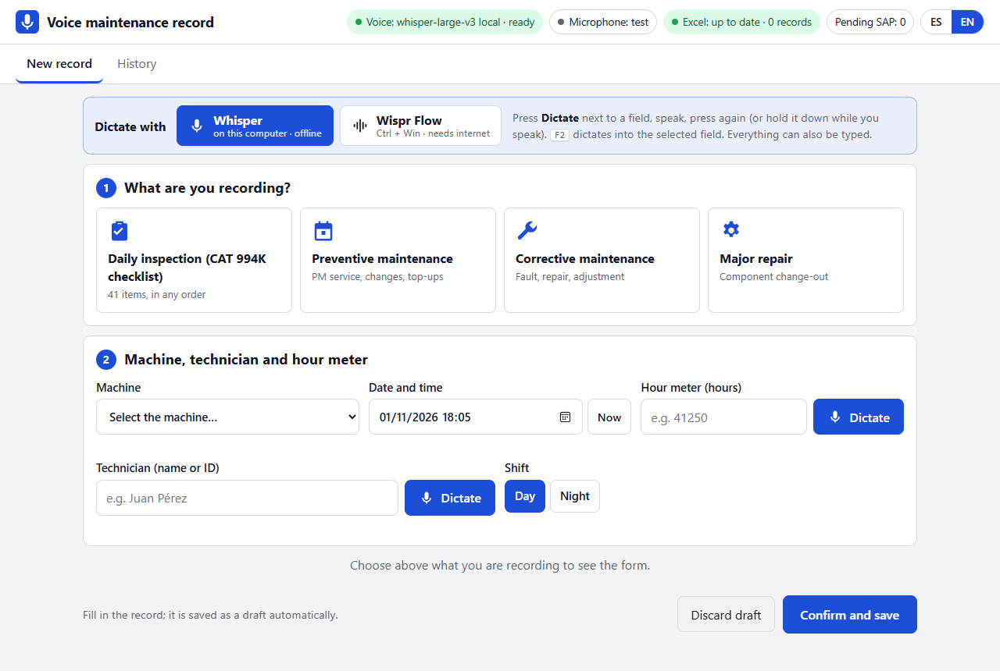
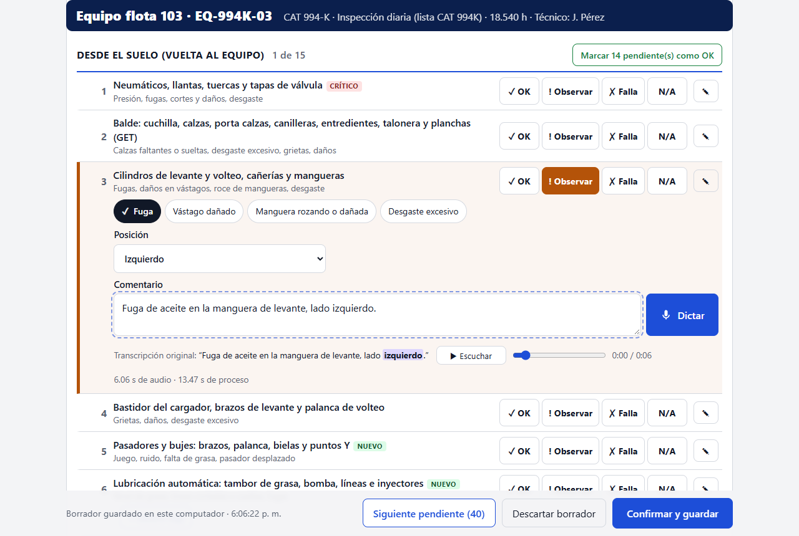

# Mining Voice Maintenance Assistant

**Voice-first daily inspections and maintenance records for mining equipment, running offline on a laptop.**

Technicians record a CAT 994K daily inspection or a maintenance job by tapping large buttons and speaking.
Speech is transcribed on the computer's CPU by **openai/whisper-large-v3** (or, optionally, by the Wispr Flow
desktop app). Every record is saved in a local database and an Excel workbook, ready for SAP. The screen is in
Spanish or English.



Why it exists, the design principles and how to evaluate it: **[THESIS.md](THESIS.md)**.

## Features

- **Daily inspection for the CAT 994K: 41 items in the order of the OEM wheel-loader form.**
  - Duplicates are merged and 994K-specific items added (GET, autolube, pins, VIMS alarms, brake and steering tests, fire suppression).
  - One tap per item: **OK / Monitor / Fault / N/A**.
  - A fault opens one-tap defect chips, a position dropdown and a comment to dictate.
  - Items can be done in any order; all must be marked before saving.
  - Per section, *Mark N pending as OK* marks only what is still unanswered.
- **Maintenance jobs** (preventive, corrective, major repair): SAP order class, order and notification
  numbers, job description, and one line per compartment with finding, action taken and recommended action.
- **Top-ups** (oil, coolant, grease) with compartment, quantity and unit, from the checklist or from a compartment line.
- **Machine status at the end:** Operational, Operational with restriction, Grounded – scheduled maintenance, or Grounded –
  emergency (breakdown); downtime hours; a warning when a safety-critical item has a fault.
- **Two dictation engines.**

  | | Whisper (default) | Wispr Flow (optional) |
  |---|---|---|
  | Runs | on this computer, offline | in Wispr's cloud, needs internet |
  | Speed on a laptop CPU | about 10 s | about 1–2 s |
  | Audio | kept, with replay (play / pause / seek) | not kept by the app |

  Every field has its own dictate button (tap to start and stop, or hold while speaking).
  **F2** dictates with Whisper; **Ctrl+Win** with Wispr. In Wispr mode the button holds Wispr's push-to-talk shortcut for you.
- **Evidence:** the original transcript stays under each field, with negations, numbers and sides highlighted.
- **Outputs:** SQLite database and an Excel workbook with these sheets:
  - Registros
  - Inspeccion (one row per item)
  - Detalle
  - Rellenos (top-ups)
  - Grabaciones (dictations)
  - Diccionario (column names with English)
  - Léame

  The workbook is rewritten on every save and catches up automatically if Excel had it open.
- **Desktop app:** a shortcut opens the app in its own window, and closing the window stops it.
- **Spanish / English screen**, switchable at any time; Whisper dictates in the screen language.

| Start: dictation engine and what is being recorded | Spanish screen: dictated comment with its raw transcript and replay |
|---|---|
|  |  |

## Quick start (Windows 10/11)

Needs Python 3.11 or newer, Microsoft Edge, about 8 GB of RAM and 6 GB of free disk.

```powershell
git clone https://github.com/AdityaAero/mining-voice-maintenance-assistant.git
cd mining-voice-maintenance-assistant
python -m venv .venv
.venv\Scripts\python.exe -m pip install -r requirements.txt
.venv\Scripts\python.exe -m pip install torch --index-url https://download.pytorch.org/whl/cpu
.venv\Scripts\python.exe download_model.py        # downloads whisper-large-v3 (3 GB) and converts it to int8 (once)
```

Your fleet: copy `data/machines.example.csv` to `data/machines.csv` and replace the example machines with your
own. `data/machines.csv` is ignored by git, so your fleet list stays private.

Start it:

- **Like a program:** `powershell -ExecutionPolicy Bypass -File tools\crear_accesos_directos.ps1` creates a
  *Registro de Mantención* shortcut on the Desktop and in the Start menu.
- **With a console** (for troubleshooting): double-click `start_app.bat`; the app opens in the browser at
  <http://127.0.0.1:8765>.

The first dictation asks for microphone permission once. For Wispr Flow, install it from
[wisprflow.ai](https://wisprflow.ai), sign in, and add Spanish in its language settings if technicians dictate
in Spanish.

## Using it

1. Choose what you are recording: daily inspection, preventive, corrective or major repair.
2. Fill in the machine, technician, date and time, and **hour meter**. The app shows the last saved hour meter
   and warns if the new value is lower.
3. **Inspection:** go through the 41 items in any order. Mark a fault, tap what is wrong, choose the position,
   dictate the detail, and add a top-up where oil or grease was added.
   **Maintenance:** fill in the order and add one line per compartment.
4. Choose the machine status and confirm. The record is saved locally and in Excel and queued for SAP.

Drafts save automatically; *History* reopens drafts and shows saved records (read only).

## Configuration

| Variable | Default | Meaning |
|---|---|---|
| `VOICE_PORT` | `8765` | Local port |
| `VOICE_RUNTIME` | `data/` | Folder for the database, audio and log |
| `VOICE_EXCEL` | `<runtime>/Registros_Mantencion.xlsx` | Where the workbook is written (e.g. a OneDrive folder) |
| `VOICE_MACHINES` | `data/machines.csv`, else the example | Fleet list (CSV) |
| `VOICE_ENGINE` | `faster-whisper` | `transformers` uses the original checkpoint in bf16 (needs ~4 GB RAM) |
| `VOICE_BEAM` | `5` | Whisper beam size |

Catalogs live in `data/`:

| File | Contents |
|---|---|
| `checklist_994k.json` | The inspection items in Spanish and English: defects, positions, top-ups and the critical flag. |
| `compartments.csv` | Compartment names, matching SAP and the oil laboratory. |
| `order_classes.csv` | SAP order classes; adapt them to your SAP configuration. |
| `vocabulario.txt`, `vocabulary_en.txt` | Workshop terms given to Whisper as context. |

## Project layout

```
app/server.py        local web server (FastAPI) and API
app/db.py            SQLite schema, migrations, validation (Spanish/English messages), Excel export tables
app/asr.py           Whisper engines (faster-whisper int8 / transformers)
app/wispr.py         Wispr Flow bridge (holds its push-to-talk shortcut)
app/excel.py         Excel workbook writer
app/static/          the screen: index.html, app.js, i18n.js (Spanish/English), styles.css, icon
launcher.pyw         desktop launcher (no console; stops the server when the window closes)
download_model.py    model download and int8 conversion
data/                catalogs and checklist (records are created here at run time and kept out of git)
tests/               API, browser and launcher tests
tools/               icon builder, shortcut creator
```

## Tests

```powershell
.venv\Scripts\python.exe -m pip install -r requirements-dev.txt
.venv\Scripts\python.exe tests\make_samples.py     # creates the spoken test clips (internet once)
.venv\Scripts\python.exe tests\test_api.py         # migration, save rules (ES/EN), checklist, top-ups, local-only access, Excel
.venv\Scripts\python.exe tests\test_ui.py          # real headless Edge with a simulated microphone
.venv\Scripts\python.exe tests\test_launcher.py    # desktop launcher (opens a real window for a few seconds)
```

Each test starts its own server on another port with a temporary data folder and the example fleet, so real
records are never touched. Wispr Flow's key presses are simulated in the tests.

## Privacy and security

- The server listens only on `127.0.0.1` and refuses requests from other web sites or host names.
- Records, recordings, the workbook and the fleet list never leave the computer, unless Wispr Flow is used for dictation.
- See [SECURITY.md](SECURITY.md) to report a vulnerability privately.

## Not built yet

SAP integration (records wait in a local queue), HTTPS for tablets and phones, photos of defects, narrating
several items in one recording.

## Credits and trademarks

- Speech recognition: [openai/whisper-large-v3](https://huggingface.co/openai/whisper-large-v3) (MIT), run with [faster-whisper](https://github.com/SYSTRAN/faster-whisper) and CTranslate2.
- Optional dictation: [Wispr Flow](https://wisprflow.ai), a separate commercial app.
- CAT, Caterpillar, VIMS and Duo-Cone are trademarks of Caterpillar Inc. This project is not affiliated with or endorsed by Caterpillar or Wispr.

## License

No open-source license has been chosen. Until one is added, normal copyright applies: you may view and
download the code on GitHub, but not reuse or redistribute it without the author's permission.
